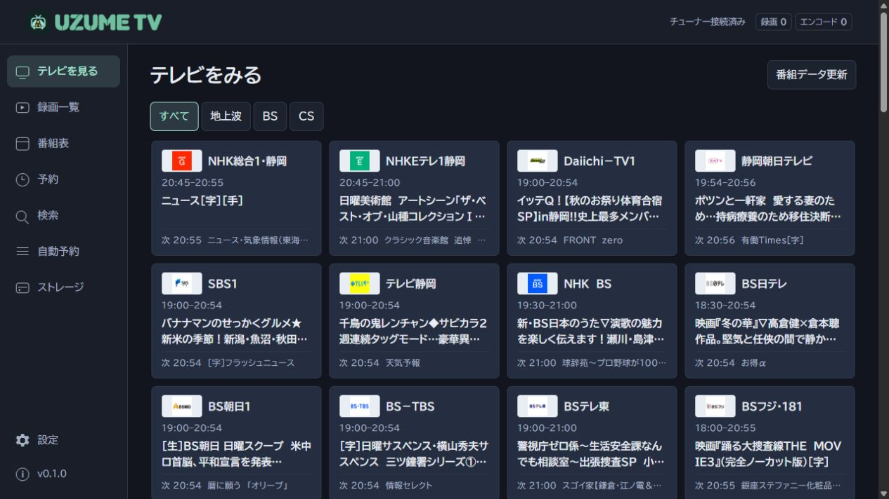
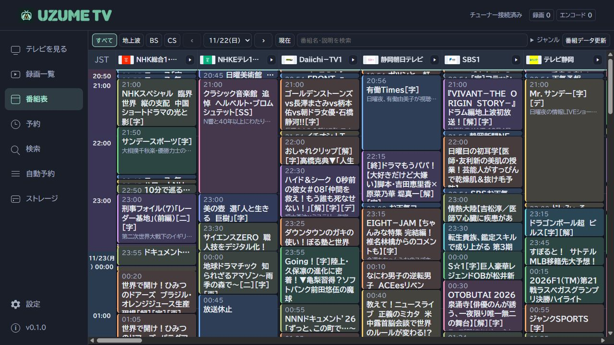
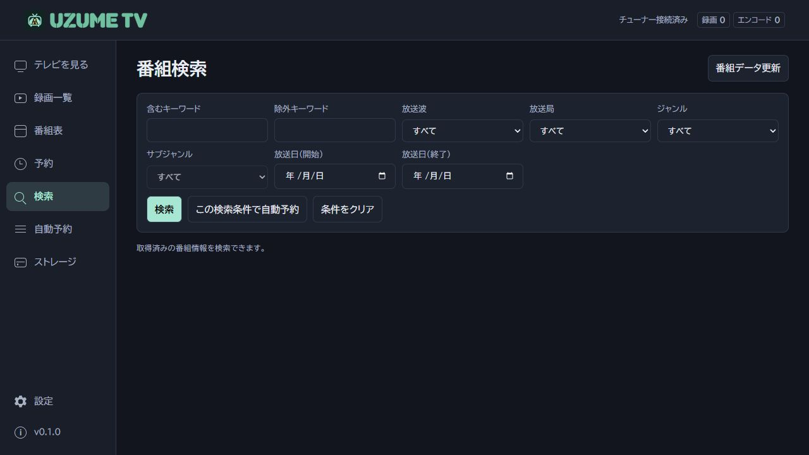
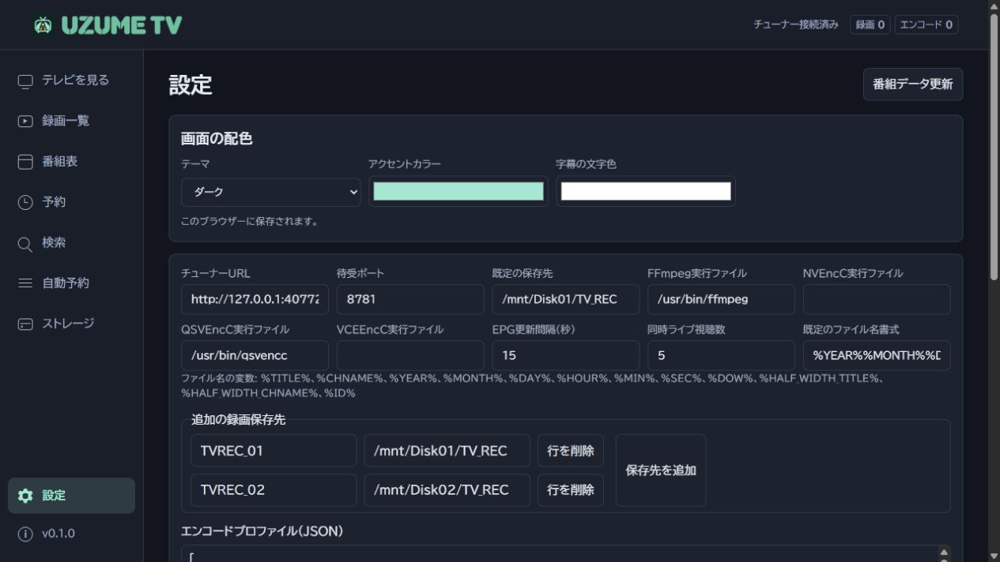

# UZUME TV 1.0.0

Mirakurun / mirakc の番組情報と MPEG-TS 配信を使うローカル録画管理アプリです。Node.js 24で動作します。パッケージのインストールは不要です。

## 画面紹介

テレビを見る画面では、放送局ごとの放送中・次の番組を確認し、ライブ視聴する局を選べます。



番組表ではジャンルごとに色分けした番組を確認し、番組を選んで詳細や録画予約を開けます。



番組検索では、キーワード・放送波・放送局・ジャンル・日付で絞り込み、検索条件を自動予約に引き継げます。



画像は2026年11月22日の画面例です。番組情報と利用できる放送局は受信環境によって変わります。

## Linuxへのインストール

systemdが動作するDebian・Ubuntu向けです。以下のコマンドは、導入先のLinuxマシンで実行してください。

### GitHubからソースを取得

Gitをインストールし、ホームディレクトリーにリポジトリをクローンします。

```bash
sudo apt-get update
sudo apt-get install -y git ca-certificates
cd "$HOME"
git clone https://github.com/trip350z/uzume-tv.git
cd uzume-tv
```

公開リポジトリのため、クローン時にGitHubへのログインは不要です。

以降のインストーラーは、この `uzume-tv` フォルダー内で実行します。すでにMirakurun / mirakcが稼働している場合は「UZUME TV本体をインストール」へ進み、接続先のURLを指定してください。

### 受信環境を新規インストール

受信環境には `install-mirakc.sh` を使います。チューナードライバー（PX4_DRVなど）、ファームウェア、カードリーダーは機器に合わせてあらかじめ準備してください。設定ファイルを作るには、先に受信ツールだけを導入してISDBScannerを実行します。スキャン中は既存のチューナーサービスを停止し、その前に録画・視聴が終わっていることを確認してください。[ISDBScannerの使い方](https://github.com/tsukumijima/ISDBScanner#isdbscanner)

```bash
sudo bash install-mirakc.sh --tools-only
sudo isdb-scanner ./scanned
sudo bash install-mirakc.sh ./scanned/mirakc/config.yml
```

YAMLを手動で用意する場合は `mirakc.config.example.yml` を参考にしてください。受信環境のインストーラーは、公式イメージからmirakcを導入し、`recisdb`、ISDBScanner、`libyakisoba`、`libsobacas`、`libaribb25` もセットアップします。mirakc一式の導入にはamd64とsystemdが必要です。`--tools-only` はamd64とarm64に対応します。mirakcは `127.0.0.1:40772` で稼働します。

### UZUME TV本体をインストール

```bash
sudo bash install-linux.sh --tuner-url http://127.0.0.1:40772
```

別のマシンのMirakurun / mirakcに接続する場合は、URLを実際の接続先に置き換えてください。`--tuner-url` を省くと初回はデモモードで起動します。既定のポートは8781で、初回に `--port 8782` のように指定できます。

対話端末での新規セットアップでは、FFmpeg・NVEncC・QSVEncC・VCEEncCの選択と、既定の録画保存先の入力が表示されます。amd64での既定の録画変換エンコーダーはQSVEncC（機器互換MP4・1080p30）で、対応するIntel GPUとドライバーが必要です。他のアーキテクチャではFFmpegが既定です。保存先の既定値は `/var/lib/uzume-tv` です。CPUでエンコードする場合は `--encoder ffmpeg`、保存先を指定する場合は `--recording-dir /mnt/recordings` を使えます。既存の保存先を使う場合は、サービスユーザー `uzume-tv` に書き込み権限が必要です。

amd64・arm64ではNode.js 24とnpmを公式配布元から取得し、チェックサム確認後にアプリ専用の場所へ展開します。FFmpeg・FFprobe、MariaDB、字幕抽出用の `aribb24.js`、CM候補検出用のComskipも導入します。別のNode.jsを使う場合は、npm付きのNode.js 24以上を `--node /path/to/node` で指定できます。

専用ユーザーで `uzume-tv.service` を起動します。予約・録画履歴・自動予約ルールはローカルのMariaDBに保存します。設定は `/etc/uzume-tv/config.json`、既定の録画先は `/var/lib/uzume-tv`、アプリは `/opt/uzume-tv` です。

互換GPUとドライバーが利用できるamd64環境では、`--encoder nvencc`、`--encoder qsvencc`、`--encoder vceencc` のいずれかを指定すると、公式Linuxパッケージを取得して導入します。初回インストールでは、選択したエンコーダーのパスと録画用プロファイルも登録します。既存環境に後から追加した場合はWebの設定画面でパスとプロファイルを指定してください。GPUドライバーとGPU固有のランタイムは、機種やOSのバージョンに合わせて用意してください。

待ち受けはLinuxマシンの `127.0.0.1` です。別のPCから利用する場合は、たとえば手元のPCでSSHトンネルを開き、ブラウザーで `http://127.0.0.1:8781/` に接続します。

```bash
ssh -L 8781:127.0.0.1:8781 ユーザー名@Linuxマシン
```

再実行するとアプリのファイルを更新し、既存設定と録画・予約データを保持します。サービス稼働中の更新は、録画・変換が終わってから `sudo systemctl restart uzume-tv` で反映します。起動ログは `sudo journalctl -u uzume-tv -n 50` で確認できます。従来のWSL版 `tuner-dvr.service` とは別のサービスです。同じマシンに新規導入する場合は空いているポートを指定してください。

旧名称のLinuxインストールから移行する場合は、録画・変換が終わってから旧サービスを停止し、自動起動を無効にしてください。設定とMariaDBの状態をバックアップし、インストーラーを実行する前に以下を行います。

1. サービスユーザーが未作成なら `sudo useradd --system --user-group --home-dir /var/lib/uzume-tv --shell /usr/sbin/nologin uzume-tv` で作成します。
2. 設定を `/etc/uzume-tv/config.json` にコピーし、所有者を `uzume-tv`、権限を `0640` にします。設定内の録画先は既存ファイルを指すようにし、新しいサービスユーザーに録画先へのアクセスを許可します。
3. MariaDBに `uzume-tv` データベースを作り、旧データベースの `dvr_state` テーブルを復元します。旧サービスで環境変数の上書きや局ロゴの追加をしていた場合は、それらも引き継ぎます。

## 設定と起動

左メニューの「設定」から、画面の配色、チューナーURL、録画保存先、エンコーダーの実行ファイルとプロファイルを変更できます。サーバー設定を変更した場合は「設定を保存」の後、録画・変換が終了した時間に「設定を反映」を実行してください。



画像の保存先や設定値は画面例です。利用する環境に合わせて指定してください。

### ホーム画面に追加する

HTTPSの公開URLからuzume-tvを開き、AndroidのChromeではメニューから「ホーム画面に追加」または「アプリをインストール」、iPhoneのSafariでは共有メニューから「ホーム画面に追加」を選びます。番組表・録画・ライブ視聴にはサーバーとの接続が必要です。

### Apacheのサブパスで公開する

サービス環境変数 `DVR_PROXY_URL` に末尾が `/` の公開URL（例 `https://example.com/uzume-tv/`）を指定します。Apache側で元のHostを渡し、公開パスを取り除いてuzume-tvに転送します。以下はHTTPSのVirtualHost内の抜粋です。例のドメインとIPアドレスは、実際の公開ドメインと接続先のIPアドレスに置き換えてください。

```apache
RedirectMatch 308 ^/uzume-tv$ /uzume-tv/
<Location /uzume-tv/>
    AuthType Basic
    AuthName "Authentication for uzume-tv"
    AuthUserFile /etc/apache2/.htpasswd
    Require valid-user
    ProxyPreserveHost On
    ProxyPass http://192.0.2.10:8781/
    ProxyPassReverse http://192.0.2.10:8781/
</Location>
```

プロキシ経由で利用するときにuzume-tvの待受ポートを変更した場合は、Apache側の転送先も変更してください。

`config.json` にチューナー接続先と、利用するエンコーダーの実行ファイルを設定します。変更はサーバーの再起動時に反映されます。

`Set-Location` には、`server.mjs` があるフォルダーのパスを指定してください。

```powershell
Set-Location "C:\path\to\uzume-tv"
node server.mjs
```

ブラウザーで http://127.0.0.1:8780/ を開きます。

| 項目 | 設定値 |
| --- | --- |
| `tunerUrl` | Mirakurun / mirakc のベースURL。 `null` でデモ |
| `port` | このPCで待ち受けるポート |
| `dataDirectory` | 録画ファイルと予約・ルールの保存先。例は `"D:/Recordings"`。 `null` なら実機は `data/recordings`、デモは `data/demo` |
| `ffmpeg` | FFmpegのパス。PATHに登録済みなら `"ffmpeg"` |
| `qsvenc` | QSVEncCの実行ファイルのパス |
| `nvencc` | NVEncCを利用する場合の実行ファイルのパス |
| `guideHiddenChannels` | 番組表、ライブ視聴、予約、自動予約から除外する放送局IDの配列。例は `[123456, 234567]` |

非表示にした局はライブ視聴と新規予約の対象外になります。既存の予約と局指定ルールは保存され、非表示設定を解除すると再表示されます。非表示のまま放送が終了した予約は取消扱いになり、録画一覧に理由が表示されます。過去の録画は引き続き再生できます。

相対パスは設定ファイルのあるフォルダーが基準です。Windowsの絶対パスは `D:/Recordings` のようにスラッシュで書けます。保存先を変更するときは、引き継ぐ録画と `dvr.json` をサーバー停止中に新しい保存先へコピーしてください。

放送局IDは、起動後にPowerShellで次のコマンドを実行すると確認できます。

```powershell
(Invoke-RestMethod 'http://127.0.0.1:8780/api/guide').services | Select-Object id, name
```

別の設定ファイルを使う場合は環境変数 `DVR_CONFIG` にそのパスを指定します。従来の `TUNER_URL`、`PORT`、`DVR_DATA`、`FFMPEG`、`NVENCC` が設定されている場合は、対応するJSONの値より優先します。

サーバーは起動時と約15秒ごとに番組表を更新し、予約時刻になるとTSファイルへ録画します。録画にはNode.jsのプロセスを起動したままにする必要があります。

- 番組表で日付と放送波を切り替え、番組名・説明を検索できます。
- 自動予約では、含む・除外キーワード、放送波、放送局、ジャンル、曜日、開始時刻の範囲を組み合わせられます。入力した条件はすべて適用されます。日付をまたぐ時間帯では、曜日は実際の番組開始日（日本時間）で判定します。既存ルールの編集・無効化・削除後は、作成済みの予約を予約画面から管理します。
- 予約画面と番組表にはチューナー競合の見込みを表示します。放送波ごとの対応機器を割り当て、同じ物理チャンネルの配信は共有できる前提で判定します。録画中の番組を優先し、同時に開始できない予約は手動予約を先に扱います。空き待ちの間に番組が終了すると録画失敗になります。外部アプリのチューナー使用状況によって実際の結果は変わります。
- EPGに放送時刻の変更が反映されると、予約および録画中の終了時刻を更新します。終了直前にもEPGを確認します。EPGでリレー先を特定できた場合は別のTSファイルとして自動予約し、「リレー」と表示します。
- 「テレビをみる」では放送波を切り替え、各局の放送中・次の番組を確認できます。局を選ぶと同じ画面でライブ再生します。番組表の「ライブ視聴」からも再生できます。既定の配信はVP8・Opus対応のFFmpegでWebMに変換します。録画にチューナーが必要になると、競合するブラウザー視聴を終了します。外部プレーヤー用のURLは番組表の視聴画面から取得できます。
- 録画一覧の「再生」で、TSはNVEncCまたはFFmpegで変換しながら配信し、MP4ファイルは保存しません。保存済みのMP4は直接再生します。「MP4に変換」はファイルを保存したい場合に使います。

既存のEPGStationからの録画・ルールの移行や、LAN利用時の認証には未対応です。

## 予約ごとの保存先とエンコード

### 録画中の空き容量確保

設定画面の「変換済みTSの自動削除・空き容量」で空き容量の基準をGB単位で指定できます。既定は10GB、0で無効です。設定保存後に「設定を反映」で反映します。

録画開始前と録画中30秒ごとに、録画先の空き容量を確認します。基準未満の場合は、同じディスク上の録画完了済み番組を録画開始時刻の古い順に調べ、MP4の映像・再生時間を確認できたもののTSを削除します。MP4と録画履歴は残ります。変換・編集・解析中の番組、HLSで再生中の番組、手動登録した動画は対象外です。削除は空き容量が基準以上になるまで行い、対象がなくなった場合は録画を続けます。空き容量の確保が間に合わない場合や削除できるTSがない場合は、録画に失敗することがあります。

左メニューの「設定」で、チューナー、待受ポート、保存先、エンコーダー、EPG更新間隔、同時ライブ視聴数、非表示局を変更できます。保存後にサーバーを再起動してください。既定の保存先を変更する場合は、停止中に既存の `dvr.json` と録画を移してください。

既定のファイル名は `recordedFormat` で設定し、番組予約や自動予約ごとに上書きできます。たとえば `%YEAR%-%MONTH%-%DAY%_%HOUR%%MIN%_%TITLE% [%CHNAME%]` を指定できます。日時は日本時間です。ファイル拡張子は自動で付き、同名の場合は録画IDが追加されます。書式は新規予約の作成時に適用されます。

`config.json` に保存先を名前とパスの組で追加すると、番組詳細と自動予約ルールでTS・MP4の保存先を選べます。

```json
"recordingDirectories": {
  "ドラマ": "./data/drama",
  "MP4保管": "./data/mp4"
}
```

この例は既存のJSONオブジェクトの中に追加します。相対パスは設定ファイルの場所が基準です。予約時の保存先を予約データに記録します。ルールの保存設定を変更すると、以後作成される予約に反映されます。録画後の自動変換を有効にすると、録画完了後にMP4を作成します。元TSの削除は明示的に選択した場合に限り、MP4保存後に実行します。

## 録画用エンコードプロファイル

「設定」の「録画変換の既定プロファイル」で、個別のプロファイルを指定していない録画のMP4変換に使うプロファイルを選べます。設定ファイルでは `defaultEncodeProfile` に登録済みのエンコードプロファイル名を指定します。CMカットとロゴ消しはFFmpegで前処理し、映像の圧縮には選択されたプロファイルを使います。

`config.json` の `encodeProfiles` に、名前・エンコーダー・引数の配列を登録します。「設定」画面でも編集でき、再起動後に番組予約・自動予約で選択できます。録画後の自動変換と録画一覧からの変換に適用されます。

```json
{
  "qsvenc": "/usr/bin/qsvencc",
  "vceenc": "/usr/bin/vceencc",
  "encodeProfiles": [
    {"name": "FFmpeg 省容量", "encoder": "ffmpeg", "args": ["-vf", "yadif", "-c:v", "libx264", "-crf", "26", "-c:a", "aac"]},
    {"name": "Intel H.264", "encoder": "qsvenc", "args": ["--avsw", "--codec", "h264", "--vbr", "4500", "--audio-codec", "aac"]},
    {"name": "AMD H.264", "encoder": "vceenc", "args": ["--avsw", "--codec", "h264", "--vbr", "4500", "--audio-codec", "aac"]}
  ]
}
```

上記の項目を既存の設定に追加し、実行ファイルのパスと引数は利用環境に合わせます。`encoder` は `ffmpeg`、`nvencc`、`qsvenc`、`vceenc` のいずれかです。入力・出力パスとMP4形式はアプリが指定するため、`args` には画質や音声などのオプションだけを書きます。既存の予約はプロファイルを名前で参照します。引数を変えると未変換の録画にも適用されます。

## MariaDBに予約を保存する

WSL版はサービス環境の `DVR_MARIADB_DATABASE=tuner_dvr` で、予約、録画履歴、自動予約ルールを MariaDB の `dvr_state` に保存します。接続にはローカルの Unix ソケットを使用します。最初の起動時に既存の `dvr.json` を取り込み、以降は MariaDB を読み書きします。録画ファイルは設定したフォルダーに保存されます。

## 局ロゴを補う

### CM検出用の局ロゴ

公式Amatsukaze Linux版を使う場合、`DVR_JLS_AMATSUKAZE` に `AmatsukazeCLI` の絶対パスを設定できます。この構成では、同梱の `chapter_exe`、`join_logo_scp`、`tsreadex` を使用し、透過ロゴの照合はAmatsukazeが行います。配布物の `exe_files`、`JL`、`avs` の相対配置を維持してください。

`DVR_JLS_LOGO_GENERATOR` にLinux版 `AmatsukazeGenLogo` の実行ファイルの絶対パスを追加すると、CM検出時に局のロゴが未登録なら、元の録画TSから自動生成します。実行ファイルに対応する `libAmatsukaze.so` も利用可能にしてください。生成時にはサービスユーザーが `DVR_JLS_LOGOS` に書き込める必要があります。成功時は局IDで保存して次回も使用し、生成に失敗した場合はComskipに切り替えます。[AmatsukazeGenLogoの仕様](https://github.com/rigaya/Amatsukaze/blob/master/doc/AmatsukazeGenLogo.md)

Linuxで `chapter_exe`、`logoframe`、`join_logo_scp` をサービスのPATHに置き、AviSynth+とL-SMASH Worksを利用できるようにします。systemdのサービス環境で `DVR_JLS_SCRIPT` にJLスクリプトの絶対パス、`DVR_JLS_LOGOS` にCM検出用ロゴのディレクトリの絶対パスを設定します。JLスクリプトとそれが参照する関連ファイルは同じ配布セットから配置してください。

放送局IDが `400151` の場合、ロゴを `400151.lgd` または `400151.lgd2` として配置します。録画の放送局IDから対応するロゴを選びます。ここで使うロゴは映像に重畳された透過ロゴの解析データです。番組表用のPNGとは形式と用途が異なります。局ロゴデータが未登録の局はComskipで検出します。[Linux版join_logo_scpの構成](https://github.com/tobitti0/JoinLogoScpTrialSetLinux)


ライブ視聴画面はチューナーの局ロゴを優先します。取得できない局のPNGは、アプリの `logos` フォルダーに `ネットワークID-サービスID.png` という名前で置けます。例として、BS日テレは `logos/4-141.png` です。WSLでアプリをホームディレクトリーの `tuner-dvr` に配置した場合、ロゴの保存先は `$HOME/tuner-dvr/logos` です。[KonomiTVの局ロゴ](https://github.com/tsukumijima/KonomiTV#局ロゴ)

## QSVEncCでライブ視聴と録画のMP4変換

`config.json` の `qsvenc` にQSVEncCの実行ファイルのパスを指定します。「設定」の「ライブ用エンコードプロファイル」でQSVEncCを選んだプロファイルを作り、「ライブ視聴の既定プロファイル」に設定します。エンコードにはIntel Quick Sync Video対応のGPUとドライバー、ブラウザーでの再生にはH.264・AAC対応が必要です。[QSVEncCの公式配布物](https://github.com/rigaya/QSVEnc/releases)

録画をQSVEncCでエンコードする場合は、「録画変換の既定プロファイル」でQSVEncCのプロファイルを選び、録画一覧の「MP4に変換」を使います。変換済みのMP4はブラウザーで直接再生できます。

## Amatsukazeの自動セットアップ

amd64環境では、本体の `install-linux.sh` が公式Linux版Amatsukaze 1.1.1.7を取得し、SHA-256確認後に `/opt/uzume-tv/runtime/amatsukaze-1.1.1.7` へ展開します。CM解析・ロゴ生成・映像編集のツールと同梱ライブラリーを配置し、systemdの `10-amatsukaze.conf` に `DVR_JLS_AMATSUKAZE`、`DVR_JLS_LOGO_GENERATOR`、`DVR_JLS_SCRIPT`、`DVR_JLS_LOGOS` を設定します。ロゴ解析データの保存先は `/var/lib/uzume-tv/jls-logos` です。

既存の個別の `DVR_JLS_*` 設定や環境ファイルがある場合は、その設定を優先します。自動導入を省く場合は `--no-amatsukaze` を指定します。arm64ではAmatsukazeの自動導入を省きます。ロゴ消しを利用する際は、QSVEncCの録画変換プロファイルを選び、局ごとのロゴデータを登録するか「ロゴを抽出」で生成してください。[公式Linux配布物](https://github.com/rigaya/Amatsukaze/releases/tag/1.1.1.7)

## インストール済み環境のアップデート

録画・変換・CM解析・ライブ視聴が終わった時間に更新します。作業フォルダーで変更したファイルがある場合は、先に保存・コミットしてから最新版を取得してください。

```bash
cd /path/to/uzume-tv
git pull --ff-only
backup="/var/backups/uzume-tv-$(date +%Y%m%d-%H%M%S)"
sudo mkdir -m 700 "$backup"
sudo cp -a /etc/uzume-tv /opt/uzume-tv /etc/systemd/system/uzume-tv.service "$backup/"
if [ -d /etc/systemd/system/uzume-tv.service.d ]; then
    sudo cp -a /etc/systemd/system/uzume-tv.service.d "$backup/"
fi
sudo systemctl stop uzume-tv
sudo mariadb-dump --single-transaction uzume-tv | sudo tee "$backup/database.sql" > /dev/null
# 保存先やエンコーダーなど、既存の設定を読み込んで更新
sudo bash install-linux.sh
sudo systemctl restart uzume-tv
sudo systemctl status uzume-tv --no-pager
sudo journalctl -u uzume-tv -n 50 --no-pager
```

インストーラーは既存の設定ファイルと録画・予約を引き継ぎます。Amatsukazeを新しいバージョンへ更新する場合はバージョン別のディレクトリーに展開します。独自のAmatsukaze設定がある場合は、更新後にその設定先も確認してください。起動後はWeb画面で予約・録画一覧と、CM解析・ロゴ消しの動作を確認します。
